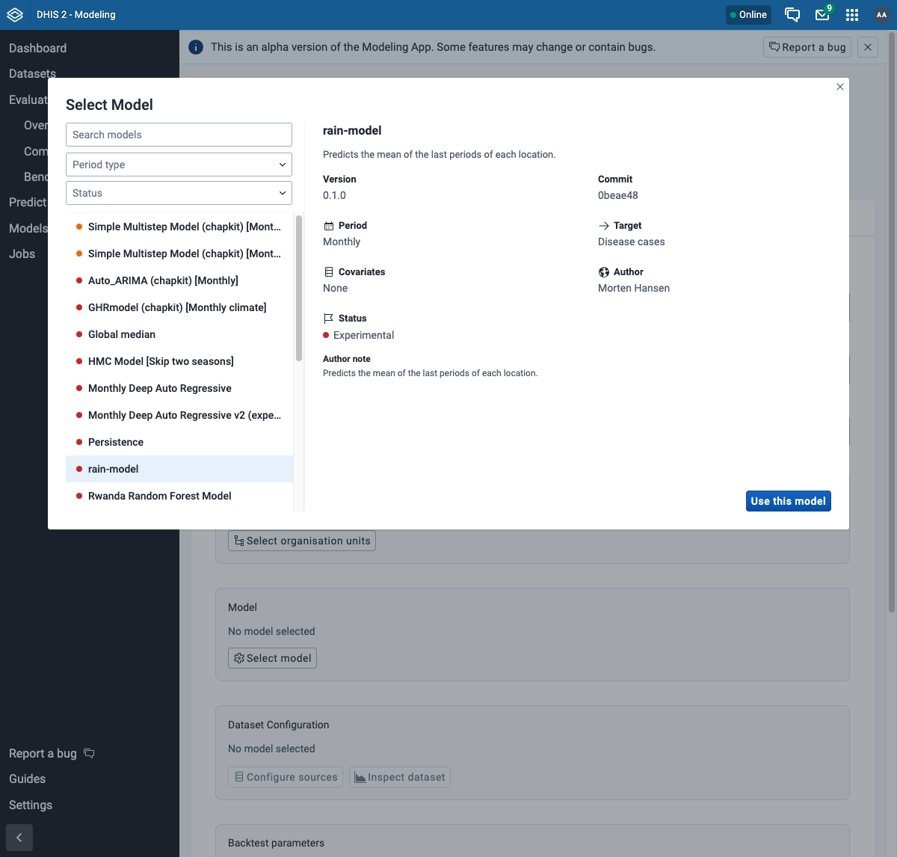
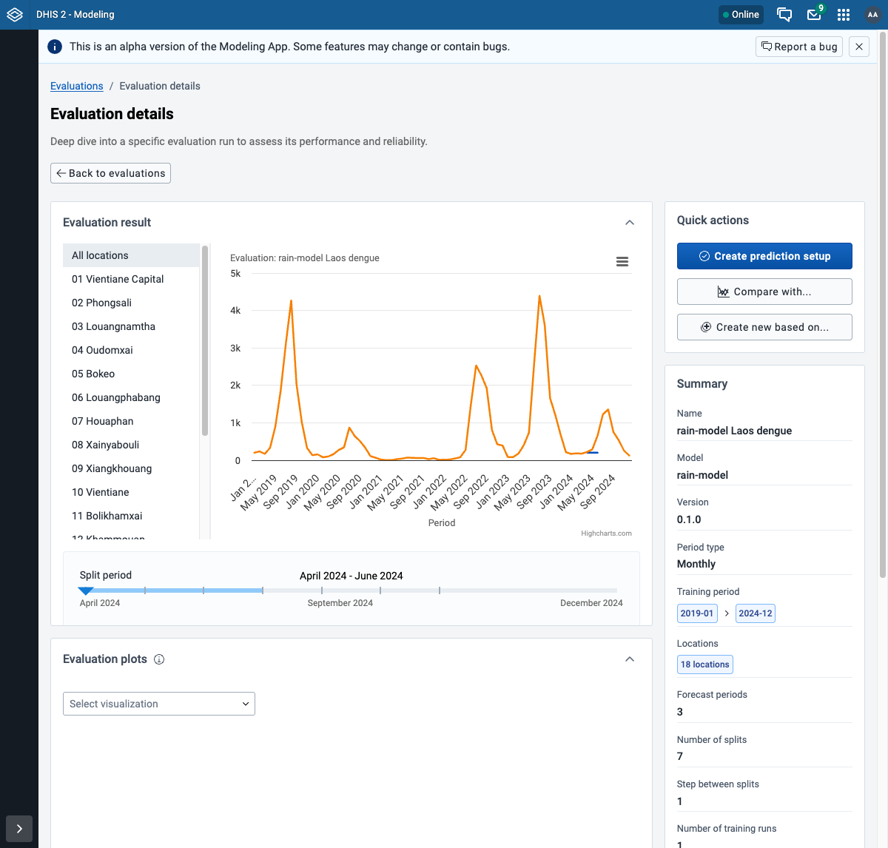

# An MLproject model, with no image to build

For a model in the MLproject format: a directory with an `MLproject` file and
the train and predict scripts. `varde chapkit mlproject run` serves it as a
chapkit service from the directory, so you can evaluate it, test it through
chap-core and change it without a `docker build`. When the model is ready,
`varde chapkit mlproject migrate` makes it a chapkit service with an image of
its own, and `varde chapkit mlproject export` goes the other way. Python, uv,
R and the chapkit CLI are not necessary on the machine.

`mlproject run` uses chapkit images of its own, so it works with chap-core
v2.4.0 and later. `export`, `--run-config.as-chapkit` and the up-to-date
`migrate` need chapkit 2.4.0 in the chap-core image, which chap-core v2.5.0
has.

## Make or bring the model

A model from chap-models, or your own, works as it is. For a new one:

```sh
varde models new rain-model --template mlproject-r
cd rain-model
git init && git add . && git commit -m "feat: first version"
cd ..
```

```text
created rain-model in rain-model (mlproject-r template, service id rain-model)
next: run `varde chapkit mlproject run rain-model` to serve it with no build, or build the image as `rain-model/README.md` says
```

For Python, use `--template mlproject-py`. The commit is not necessary to
serve the model, but chap-core stores a model only with a git revision. See
[In a deployment](#in-a-deployment).

## Serve it

```sh
varde chapkit mlproject run rain-model
```

```text
serving /home/me/rain-model with `chapkit mlproject run` in ghcr.io/dhis2-chap/chapkit-r-tidyverse-cli:latest (from the train command `Rscript scripts/train.R --data {train_data} --model {model} --config {model_config}`; --image picks another)
starting it on http://localhost:5001; the logs follow, and Ctrl-C stops it
the MLproject service answers at http://localhost:5001
```

It worked when the last line says `the MLproject service answers at`. The
service runs in the foreground, and the logs of chapkit follow. Leave it
running, and use a second terminal for the next steps. Ctrl-C stops it:

```text
stopped the MLproject service on http://localhost:5001
```

The train command selects the image: `python` or `uv` gets `py-data`, and
`Rscript` gets `r-tidyverse`. A model that needs INLA gets
`--image r-inla`. To see the images, run `varde chapkit --image`:

```text
NAME         IMAGE                                              PLATFORMS     LOCAL  WHAT IT HAS
py           ghcr.io/dhis2-chap/chapkit-py-cli:latest           amd64, arm64  yes    Python
py-data      ghcr.io/dhis2-chap/chapkit-py-data-cli:latest      amd64, arm64  yes    Python, numpy, pandas, scipy, scikit-learn, statsmodels, ...
r            ghcr.io/dhis2-chap/chapkit-r-cli:latest            amd64, arm64  no     R, renv, pak
r-tidyverse  ghcr.io/dhis2-chap/chapkit-r-tidyverse-cli:latest  amd64, arm64  yes    R, tidyverse, fable, tsibble, forecast, xgboost, ...
r-inla       ghcr.io/dhis2-chap/chapkit-r-inla-cli:latest       amd64         yes    R, tidyverse, INLA, sf, spdep, dlnm, ...
```

varde does not install the packages that `uv_env` or `renv_env` names. If
the model needs one that the image does not have, give an image that has it.
See [Serve an MLproject model](../chapkit-cli.md#serve-an-mlproject-model).

## Evaluate it

The chap CLI runs in a container, so it reaches the service at
`host.docker.internal`, not at `localhost`:

```sh
varde chap eval --model-name http://host.docker.internal:5001 \
  --dataset-csv laos_subset.csv --output-file rain-model.nc
```

```text
model: http://host.docker.internal:5001 answers
chap finished; it wrote rain-model.nc
`varde chap plot-backtest rain-model.nc --output-file rain-model.html` plots it
```

It worked when the line says `chap finished; it wrote rain-model.nc`. The
data comes from
[Evaluating a model on your own data](./evaluate-with-chap-cli.md).

chap can also run the directory itself, without the service. With
`--run-config.as-chapkit`, chap serves it with chapkit in its own container,
and installs what `uv_env` or `renv_env` names:

```sh
varde chap eval --model-name ./rain-model --run-config.as-chapkit \
  --dataset-csv laos_subset.csv --output-file rain-model.nc
```

## In a deployment

In a deployment that runs chap-core, the service registers with chap-core,
and the commands of the deployment use it by its id, the `name` in
`MLproject`:

```sh
varde init lab --models none
cd lab
varde up --wait
varde chapkit mlproject run ../rain-model
```

```text
the MLproject service answers at http://localhost:5001; it registers with chap-core in this deployment, which reaches it at http://varde-mlproject-18970-0:8000
```

In a second terminal, in `lab`:

```sh
varde models configs sync rain-model
varde models test rain-model --backtest
```

```text
rain-model: created configured model default
testing 1 model (through chap-core: a dataset, a backtest and its scores)
rain-model    pass      13s   crps 31.4  mae 31.4  rmse 37.5
  configured model: default (id 21)

1 of 1 model passes
```

It worked when the last line says `1 of 1 model passes`.

With DHIS2 in the deployment, the Modeling App shows the configured model
while the service runs. **Select model** lists it by its `name`, with the
commit that varde gave chapkit:



An evaluation runs as for any other model. For `rain-model`, map only
**Disease cases**, because the model has no covariates. See
[Your first forecast in the Modeling App](../modeling-app.md). This was tested
with Modeling App 7.3.0, DHIS2 2.42.6 and chap-core v2.5.0, after a
`varde update` from v2.4.0: the evaluation of the 18 provinces, 2019 to 2024,
took 19 seconds.



varde gives chapkit the git commit of the model directory, and chap-core
stores the version of the model with it. After a change, commit it, and
raise `version` in `MLproject`, before you serve the model again. If the
directory has changes that are not committed, varde warns. `varde status`
does not show the service, because varde does not manage it.

## Make it a chapkit service

When the model is ready to publish, make it a chapkit service with an image
of its own. Commit first: the migration moves files to `_old/`. Then, in the
model directory:

```sh
cd rain-model
varde chapkit mlproject migrate . --yes --base-image chapkit-r-tidyverse
docker build --platform linux/amd64 --build-arg GIT_REVISION=$(git rev-parse HEAD) -t rain-model:dev .
varde run rain-model:dev
varde -C ~/.local/share/varde/run/default models test rain_model
```

It worked when the last line says `1 of 1 model passes`. The templates keep
the scripts in `scripts/`, so `--base-image` is necessary; `README.md` gives
the correct value. A model with its scripts at the root does not need it. See
[Migrate an MLproject model](../chapkit-cli.md#migrate-an-mlproject-model).

## And back to an MLproject

A chapkit service that runs scripts, such as one from the `shell-py` or
`shell-r` template, can write the `MLproject` of the same model:

```sh
cd my-service
varde chapkit mlproject export main.py -o MLproject
varde chapkit mlproject run .
```

```text
chapkit finished; it wrote MLproject
```

The exported `MLproject` runs with `varde chapkit mlproject run` and with
`--run-config.as-chapkit`, not with `varde chap` alone. See
[Export a service as an MLproject](../chapkit-cli.md#export-a-service-as-an-mlproject).

## What was tested

On chap-core `master` before v2.5.0 (chapkit 2.4.0), macOS arm64, each row
was served with `varde chapkit mlproject run` and evaluated with
`varde chap eval`. On v2.5.0, the `mlproject-py` template was migrated and
tested again, and the `shell-r` template was exported, served and evaluated
again, with no `--tag`:

| Model | Image | Result |
| --- | --- | --- |
| `mlproject-py` template | `py-data` (default) | pass |
| `mlproject-r` template | `r-tidyverse` (default) | pass |
| `shell-py` and `shell-r` templates, exported | the default | pass |
| `minimalist_configurable_model` | `py-data` (default) | pass |
| `minimal_template_example` | `py-data` (default) | pass |
| `Xiang_SVM` | `py-data` (default) | pass |
| `mean` | `r-tidyverse` (default) | pass |
| `XGBoost_for_Malawi` | `r-tidyverse` (default) | pass |
| `INLA_baseline_model` | `--image r-inla` | pass |
| `ewars_per_district` | `--image r-inla` | pass |
| `chap_pymc` | `py-data` (default) | fails: the image has no `cyclopts`, which its `uv_env` names |
| `IMPA-TECH-SARIMA` | `py-data` (default) | fails in the model, also without varde |
| `rwanda_random_forest` | `py-data` (default) | fails in its train script |
